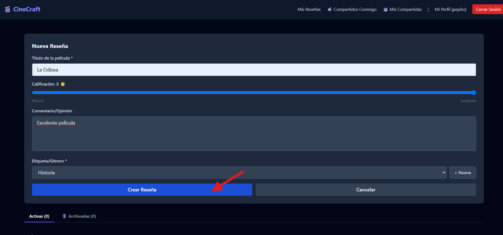
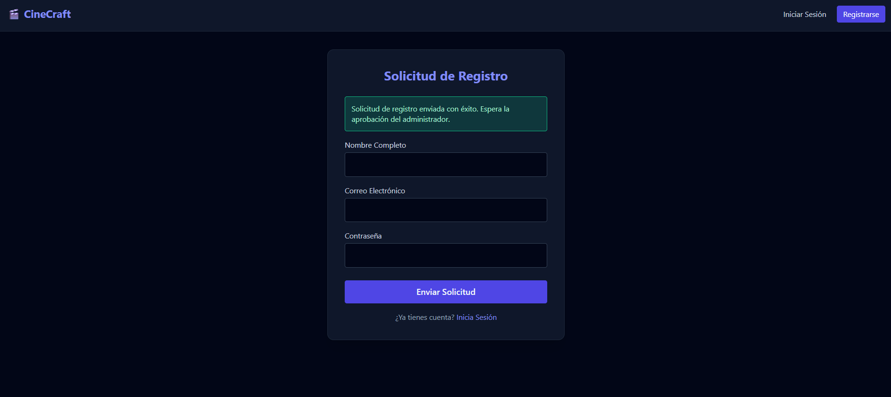
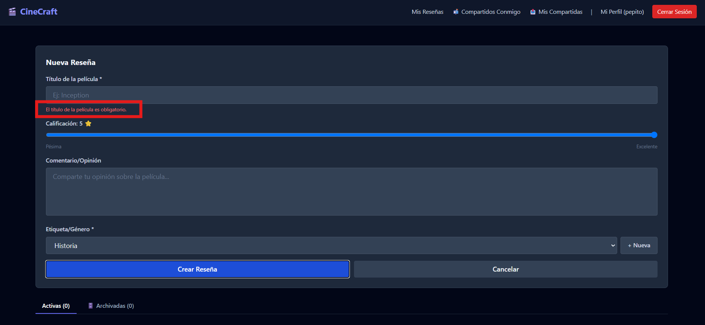
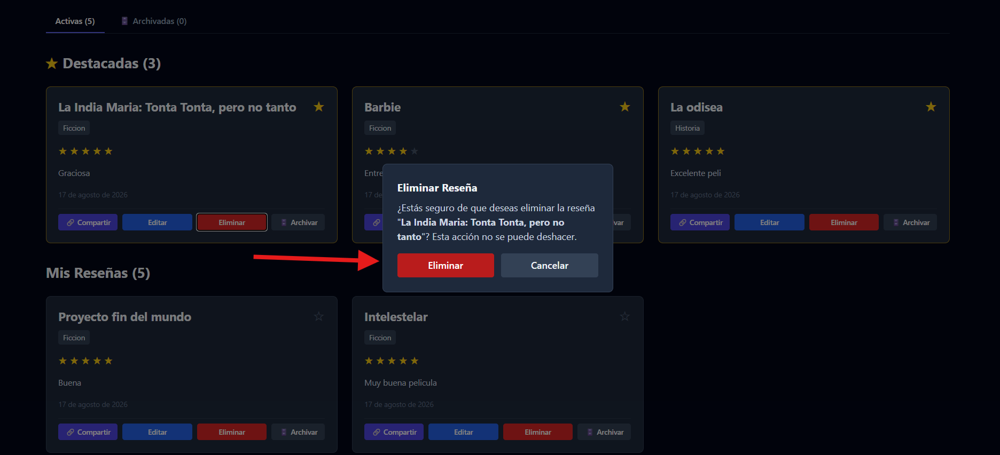
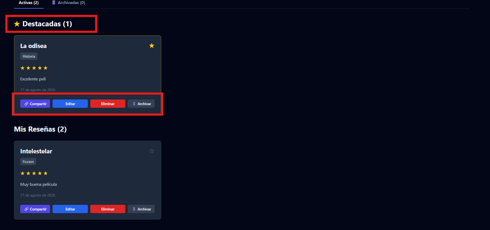
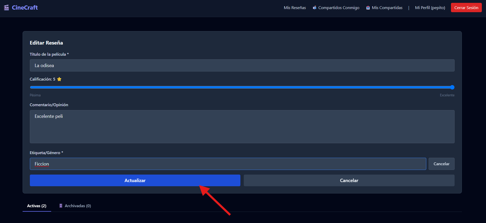
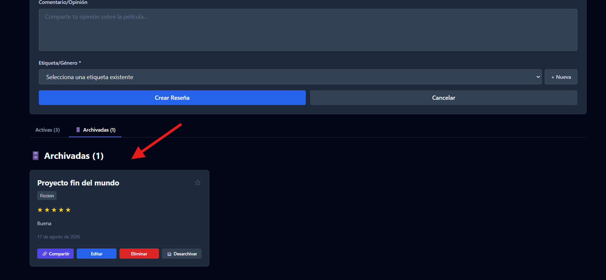
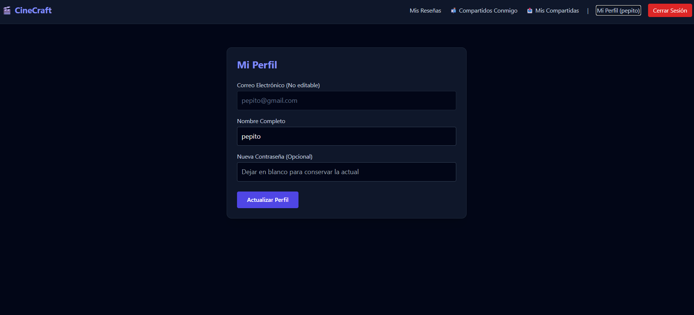
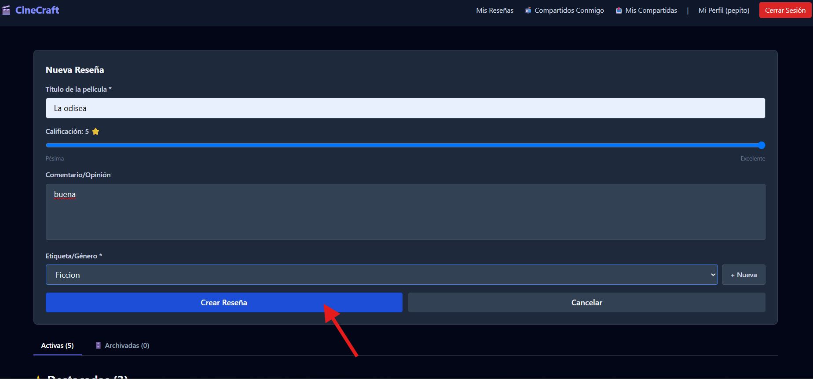
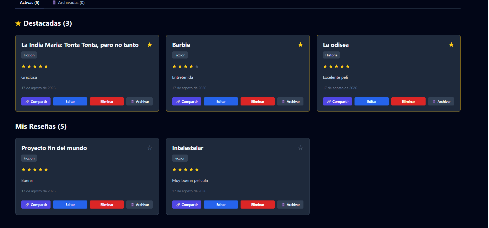

# Evidencias UI/UX de CineCraft

## Objetivo

Este documento reúne las capturas obtenidas desde CineCraft en funcionamiento para demostrar la aplicación de los seis principios de Jakob Nielsen seleccionados por el equipo.

Todas las imágenes se almacenan en `docs/img/`, utilizan datos de prueba y fueron revisadas para evitar contraseñas, tokens, variables de entorno o credenciales.

## Matriz de evidencias

| N.º | Principio | Evidencia observada | Archivo | Estado |
|---:|---|---|---|---|
| 1 | Visibilidad del estado del sistema | La acción principal para crear una reseña se distingue con claridad; la confirmación verde del registro complementa la evidencia del resultado de una operación. | `principio-01-visibilidad-estado.png` | Completada |
| 2 | Prevención de errores | El formulario impide continuar sin título y presenta un mensaje específico junto al campo. | `principio-02-prevencion-errores.png` | Completada |
| 3 | Coincidencia entre el sistema y el mundo real | Las estrellas y las acciones de compartir, editar, eliminar y archivar utilizan conceptos reconocibles. | `principio-03-mundo-real.png` | Completada |
| 4 | Control y libertad del usuario | La edición ofrece una salida mediante **Cancelar**; la pestaña de archivadas permite recuperar una reseña con **Desarchivar**. | `principio-04-control-libertad.png` | Completada |
| 5 | Consistencia y estándares | La navegación, los formularios y las acciones conservan la misma paleta oscura, tipografía y jerarquía visual en las pantallas revisadas. | `principio-05-consistencia.png` | Completada |
| 6 | Diseño estético y minimalista | El panel organiza las reseñas en tarjetas separadas, con jerarquía clara y sin decoración innecesaria. | `principio-06-diseno-minimalista.png` | Completada |

## 1. Visibilidad del estado del sistema

El botón primario permite reconocer el punto en el que se ejecuta la creación de la reseña. Como evidencia complementaria, el registro muestra un mensaje verde que comunica que la solicitud fue enviada correctamente.

## 2. Prevención de errores

Antes de enviar información incompleta, el formulario identifica el campo requerido y explica el problema al usuario.

La confirmación de eliminación agrega una segunda barrera antes de una acción permanente.

## 3. Coincidencia entre el sistema y el mundo real

La calificación con estrellas y los nombres de acciones como **Eliminar** y **Archivar** corresponden con conceptos familiares para el usuario.

## 4. Control y libertad del usuario

El formulario de edición incluye **Cancelar** para abandonar los cambios. Además, el archivado es reversible mediante la acción **Desarchivar**.

## 5. Consistencia y estándares

La pantalla de perfil mantiene la misma navegación, colores, controles y estilos tipográficos usados en el formulario de reseñas y las demás vistas del sistema.

## 6. Diseño estético y minimalista

Las reseñas se presentan con una estructura repetible, suficiente separación y contenido breve que facilita recorrer el panel.

## Revisión de cierre

- [x] Las seis evidencias principales existen y abren correctamente.
- [x] Cada principio posee al menos una captura identificable.
- [x] Las capturas complementarias refuerzan los estados o acciones que requieren más de una vista.
- [x] No se muestran contraseñas, tokens, variables de entorno ni credenciales.
- [x] Los archivos están en formato PNG y utilizan rutas relativas válidas.
- [x] El Manual de Usuario contiene las capturas de sus funciones principales.

La evidencia queda lista para revisión e integración desde la rama `feature/uiux-evidence_202308204`.
